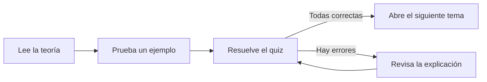

# ITERA Learn

**Laboratorio interactivo de métodos numéricos**

Aprende a estimar errores, comprobar la precisión de tus resultados y entender cómo se comportan los métodos iterativos. ITERA reúne teoría, ejemplos y práctica en el navegador.

**[Entrar al portal en GitHub Pages](https://suarezsh.github.io/itera-learn/)** · [Abrir el Módulo 1](https://suarezsh.github.io/itera-learn/modulo-1/)



## Módulo 1 · Errores numéricos

| Sección | Qué aprenderás |
| --- | --- |
| 01 · Introducción | Cuándo conviene aproximar una solución y por qué hay que medir su error. |
| 02 · Redondeo y truncamiento | Cómo cambia un número al limitar sus decimales. |
| 03 · Error absoluto y relativo | Cómo medir la diferencia y ponerla en proporción al valor verdadero. |
| 04 · Clasificación de errores | Cómo distinguir errores inherentes, de truncamiento y de redondeo. |
| 05 · Cifras significativas | Qué dígitos expresan la precisión de una medición o un resultado. |
| 06 · Propagación | Cómo se transmiten las incertidumbres al operar con datos. |
| 07 · Condicionamiento | Cuánto puede cambiar un resultado ante una perturbación pequeña. |
| 08 · Convergencia | Cómo estimar la velocidad a la que disminuye el error. |

## Cómo se estudia



- **Cinco calculadoras interactivas** con gráficos para redondeo, error absoluto y relativo, cifras significativas, propagación y convergencia.
- **Ejercicios con variantes**. Los ejercicios numéricos generan nuevos datos y recalculan sus respuestas. Las alternativas cambian de orden.
- **Examen de 15 preguntas** con selección y respuestas numéricas escritas. Se aprueba con 10 aciertos o más.
- **Recursos de acceso libre**. Puedes abrir el [video](https://suarezsh.github.io/itera-learn/modulo-1/#video) y el [formulario de errores numéricos](https://suarezsh.github.io/itera-learn/modulo-1/#formulas) en cualquier momento.

## Ejecutar en local

El portal usa HTML, CSS y JavaScript. Desde la carpeta del repositorio, inicia un servidor estático con Python.

```powershell
python -m http.server 8000
```

Abre el [portal local](http://localhost:8000/). La página guarda el progreso en el navegador. Se requiere conexión a internet para cargar las bibliotecas externas y el video de YouTube.
